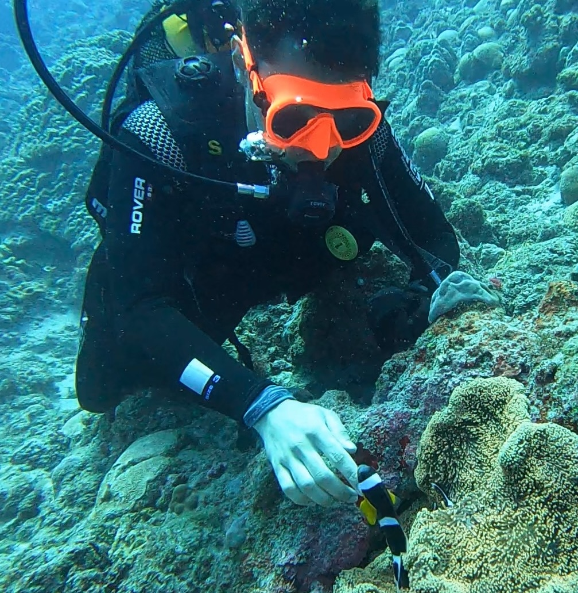
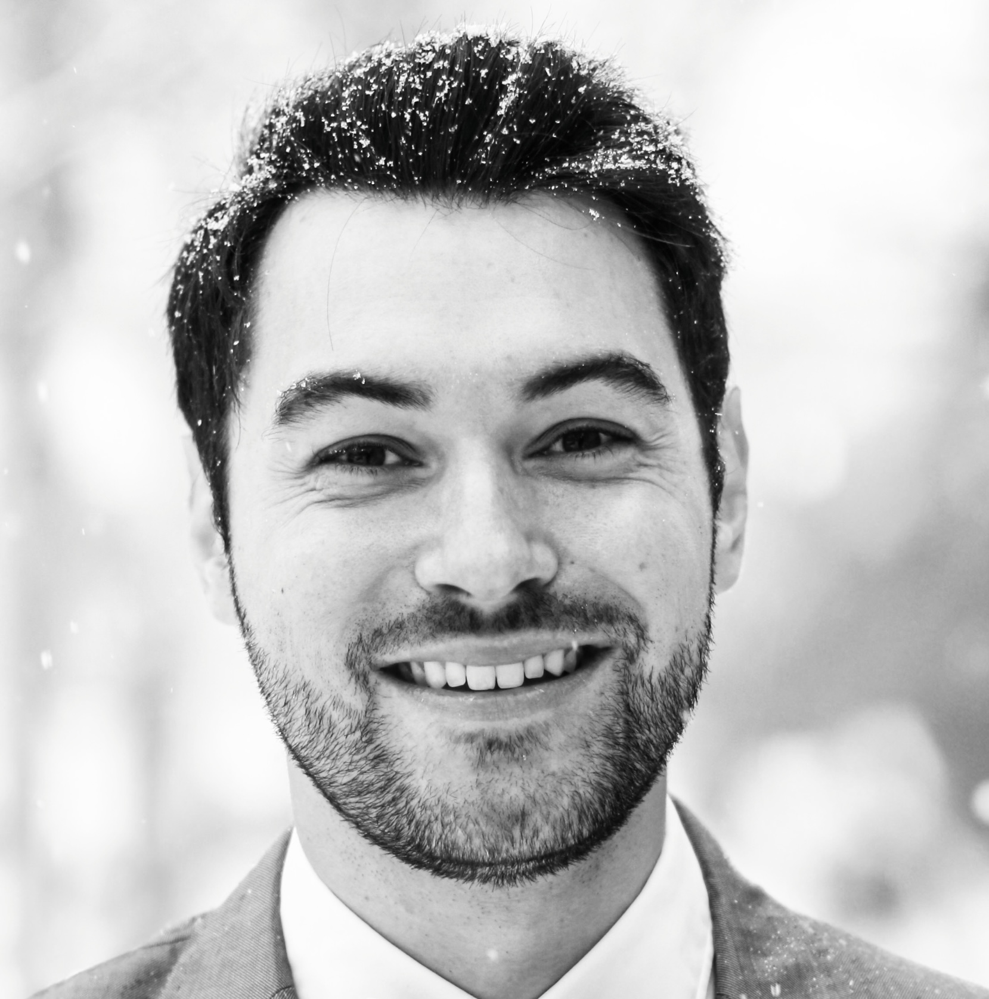

    

        <!-- Hover Image (another picture shown on hover) -->
        
        <!-- Original Profile Picture -->
        
    

    

        <h2><b>Senior Machine Learning Research Scientist</b></h2>
        <h3>Training Foundation Models to Decode the Complexity of Life</h3>
    

 

## **About Me**

I'm a **senior machine learning research scientist** at [Biohub](https://biohub.ai/), previously at [EvolutionaryScale](https://www.evolutionaryscale.ai/). I work at the intersection of machine learning and computational biology, training foundation models, from diffusion models to protein language models, to understand and design proteins for drug discovery and biology. Most recently, I was a core contributor to **ESMFold2**, where I doubled its model FLOPs utilization (MFU), making it the fastest open-source protein folding model.

Before that, I was a postdoctoral fellow at **Mila** and **McGill University** in Montréal, working with Prof. Adam Oberman and Prof. Ioannis Mitliagkas on generative modeling, distribution shifts, and optimal transport, with applications to single-cell trajectory inference and protein design. I also co-created [**TorchCFM**](https://github.com/atong01/conditional-flow-matching), an open-source library for flow matching models with over 400k downloads.

I did my PhD at **INRIA Rennes** in Brittany, France, under the supervision of Prof. Nicolas Courty and Prof. Rémi Flamary. My work explored the intersection of optimal transport and deep learning, with applications to domain adaptation, learning with noisy labels, and generative modeling. A central thread was minibatch optimal transport, which later became a building block of our flow matching work. My [thesis defense](https://www.youtube.com/watch?v=paqpidEnnHw) and [manuscript](pdf/thesis_kf.pdf) are available online, and my résumé is [here](pdf/cv_kilian_fatras.pdf).

## **Research Interests**

My current focus areas include:

- Developing novel **diffusion and flow matching** methods for protein modeling, computer vision, and tabular data.
- Building **multi-modal protein models** for folding, inverse folding, and unconditional and conditional protein generation.
- Designing **binders** against therapeutically relevant targets using sequence- and structure-based conditional methods.
- Extracting meaningful biological information from **protein language models**.
- Creating **scalable, computationally efficient architectures** for protein modeling.

For a complete list of publications, see my [Google Scholar](https://scholar.google.com/citations?hl=en&user=DHMjyDgAAAAJ&view_op=list_works).

---

**Feel free to reach out** by email or on LinkedIn (links below) if you'd like to discuss any of these topics!